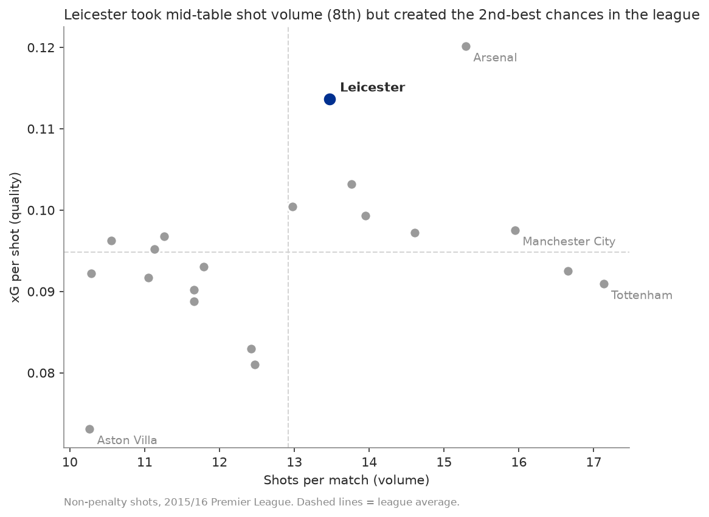
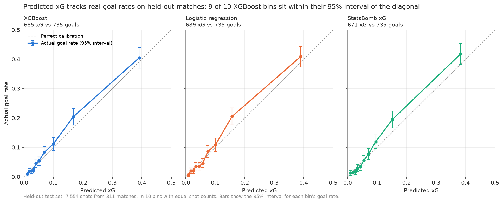
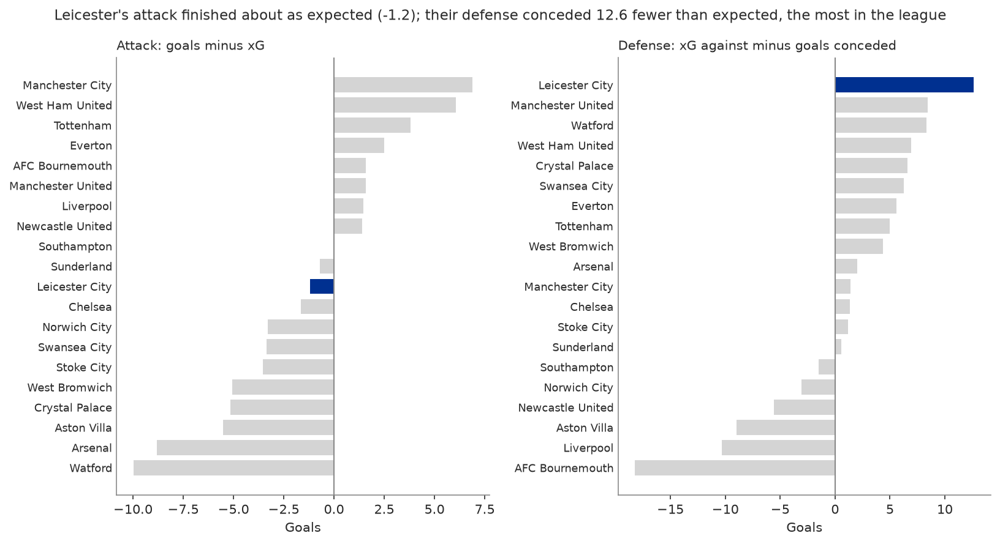
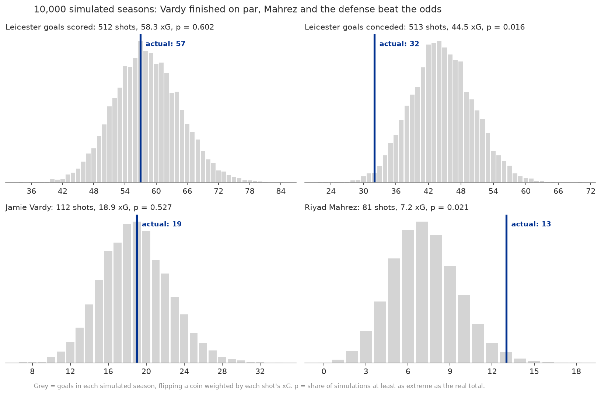
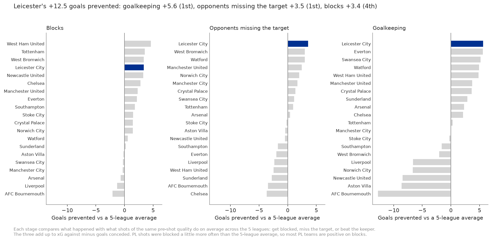
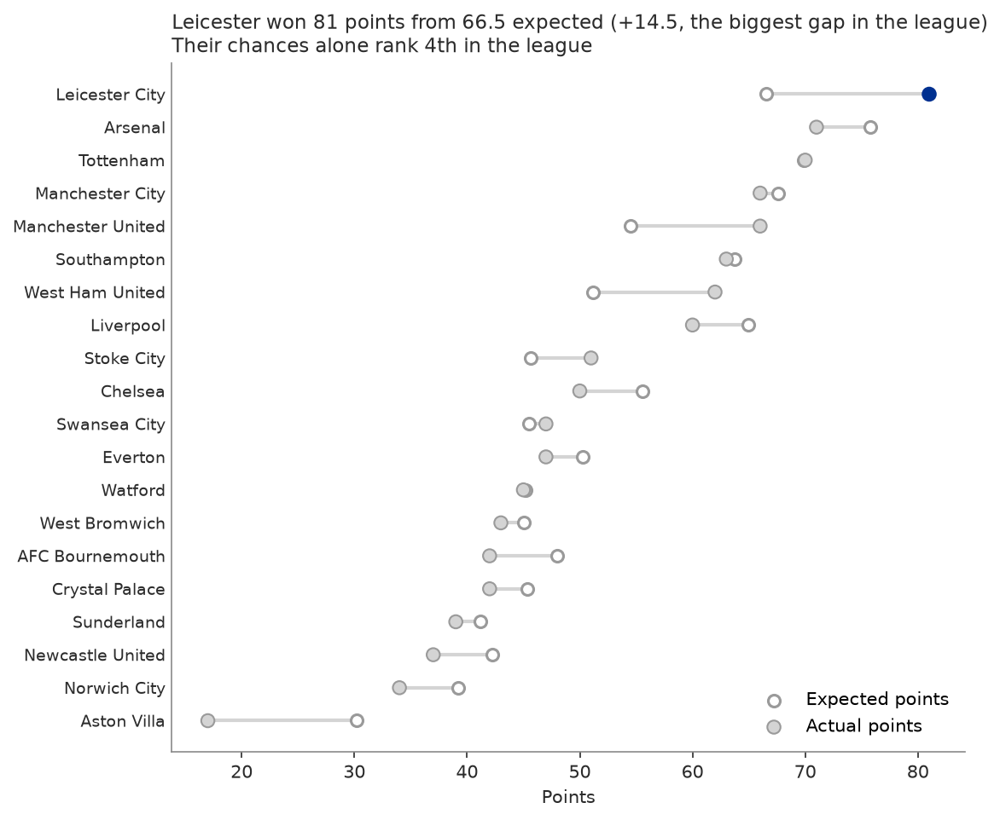
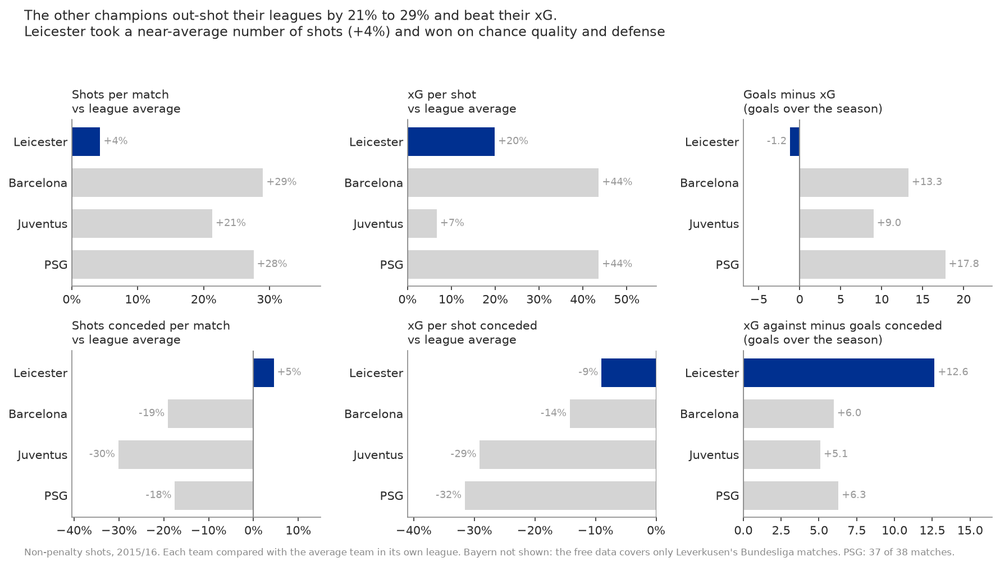
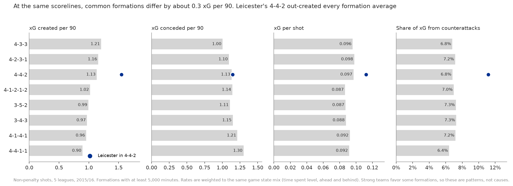

# Leicester won the 2015/16 Premier League with chance quality and a defense that beat its xG, not lucky finishing

[](https://github.com/Lucatony-Angel/leicester-xg/actions/workflows/tests.yml)

An expected goals (xG) model built from free StatsBomb event data, used to answer one question: **how did a 5000-to-1 underdog win the league: shot quality, shot volume, or finishing luck?**

**Live app:** [leicester-xg.streamlit.app](https://leicester-xg.streamlit.app/)



## Key findings

- **Quality, not volume.** Leicester averaged 0.114 xG per shot, 2nd in the league behind Arsenal, while taking only the 8th-most shots per match (13.5).
- **Their attacking finishing was average.** They scored 57 non-penalty goals from 58.3 xG. In 10,000 simulated seasons, 60% matched or beat that total. Jamie Vardy scored 19 from 18.9 xG, exactly on par.
- **The overperformance was at the other end.** Leicester conceded 32 non-penalty goals from 44.5 xG against, 12.5 fewer than expected and the most in the league (p = 0.016). It came from every stage of a shot: Kasper Schmeichel's goalkeeping (+5.6), opponents missing the target (+3.5) and blocks (+3.4).
- **Mahrez was the one standout finisher:** 13 goals from 7.2 xG (p = 0.021).
- **That gap was worth about 15 points.** Leicester won 81 points from 66.5 expected points. Their chances alone made them a top-4 side, not champions.

This wasn't how champions usually win. Barcelona, Juventus and PSG out-shot their leagues by 21% to 29% and beat their xG by 9 to 18 goals. Leicester leaned on counterattacks instead (12.4% of their xG, 1.8 times the league's share), and among 20 teams across Europe that played a 4-4-2 they created the most xG per 90 minutes.

## How sure is this?

- **Leicester were picked because they won**, and title winners tend to have overperformed. Their defense's p = 0.016 is unusual for one team, but if all 20 teams were average, the chance that at least one gets that far ahead of its xG by luck is 27%. Treat it as "a lot went right", not proof of skill.
- **No single defensive stage is extreme on its own.** Schmeichel's share alone has p = 0.137. The finding is that every stage leaned the same way.
- **Mahrez was named before looking at the data**, but 12 of 433 players with 30+ shots finished as far above their xG as he did, against about 9 expected by chance. Some of that is skill, some is a good season.

## Data

[StatsBomb Open Data](https://github.com/statsbomb/open-data), loaded with [statsbombpy](https://github.com/statsbomb/statsbombpy): 5.4M events from 1,551 matches of the 2015/16 season (Premier League, La Liga, Serie A, Ligue 1 and Bayer Leverkusen's Bundesliga matches), giving 38,728 shots.

**Data provided by StatsBomb.**


## Method

**Features** (14 per shot, built in SQL with DuckDB except for the freeze frame geometry):

| Group | Features |
|---|---|
| Geometry | Distance to goal, angle between the posts |
| Shot context | Body part, technique, free kick vs open play, play pattern, first time, under pressure, open goal |
| Assist | Through ball, cutback, cross, corner, other pass, or none (from the key pass) |
| Freeze frame | Defenders between the ball and the goal, nearest defender distance, keeper distance from line and from center |

Penalties are excluded from the model and given the overall penalty conversion rate across all 5 leagues (0.751) as their xG. Own goals aren't shots. Game state and formation are used for analysis only: the model only knows what the shot looked like.

**Models:** a distance + angle logistic regression baseline, a logistic regression with all features, and XGBoost tuned with 5-fold cross-validation. All splits are grouped by match, and 20% of matches (311) are held out until the end. Each shot's final xG comes from a model that never saw that shot's match, so a team's finishing can't leak into its own xG.

## Model results

Held-out test set: 7,554 shots from 311 matches.

| Model | Log loss | Brier | ROC AUC |
|---|---|---|---|
| Baseline (distance + angle) | 0.2788 | 0.0795 | 0.761 |
| Logistic regression | 0.2544 | 0.0732 | 0.819 |
| **XGBoost** | **0.2535** | **0.0729** | **0.821** |
| StatsBomb xG (benchmark) | 0.2513 | 0.0717 | 0.824 |

XGBoost's log loss is within 0.9% of StatsBomb's own model. Across all 38,318 non-penalty shots, the model predicts 3,646.5 goals against 3,651 actual.



The model is calibrated: shots it rates at 0.2 xG go in about 20% of the time. Distance, angle and the number of defenders in the way drive it most ([SHAP summary](figures/shap_summary.png)).

## Leicester vs the Premier League

### Finishing vs defense



### Was it luck?

Each shot is replayed 10,000 times as a coin flip weighted by its xG. The p-value is the share of simulated seasons at least as extreme as the real one.



| | Shots | xG | Actual | 90% of simulations | p |
|---|---|---|---|---|---|
| Leicester goals scored | 512 | 58.3 | 57 | 48 to 69 | 0.602 |
| Leicester goals conceded | 513 | 44.5 | 32 | 35 to 54 | 0.016 |
| Jamie Vardy | 112 | 18.9 | 19 | 13 to 25 | 0.527 |
| Riyad Mahrez | 81 | 7.2 | 13 | 3 to 11 | 0.021 |

### Where the defense beat its xG

Every shot against has to avoid a block, hit the target and beat the keeper. A model for each stage, trained on the same pre-shot features, gives how often shots of that quality get through on average. Comparing what happened with those chances splits the 12.5 goals into three parts that add up exactly:



| Stage | Goals prevented | PL rank |
|---|---|---|
| Goalkeeping (Schmeichel started all 38 matches) | +5.6 | 1st |
| Opponents missing the target | +3.5 | 1st |
| Blocks | +3.4 | 4th |

Leicester blocked 176 of 513 shots, 34 more than expected for shots of that kind, but most of them were low-value attempts, so the extra blocks are worth only +3.4 goals.

A post-shot xG model (using where shots ended up) would be the usual way to measure goalkeeping, but it doesn't work on this data: saved shots are recorded where the keeper stopped them and goals where they crossed the line, so a test model could tell goals from saves almost perfectly from the recording alone.

### Expected points



Full tables (all 20 teams, defensive stages, play patterns, assist types): [figures/leicester_results.md](figures/leicester_results.md).

## Leicester vs the other champions

Each 2015/16 champion is compared with the average team in its own league, because leagues differ in how many goals they produce.



- **The usual champions dominate the shot count.** Barcelona, Juventus and PSG took 21% to 29% more shots than their league average and allowed 18% to 30% fewer. Leicester took 4% more and allowed 5% more.
- **The giants out-finished their xG** by 9 to 18 goals. Leicester's attack finished at an average rate (−1.3).
- **All three topped their league on expected points. Leicester ranked 4th**, with an xG difference of +0.36 per match against +0.90 to +1.40 for the others.
- **Leicester leaned on counterattacks:** 1.8 times their league's share of xG from counters, against 0.5 to 1.1 times for the other champions.

Bayern Munich isn't included because the free data covers only Leverkusen's Bundesliga matches. PSG's numbers cover 37 of their 38 matches. Full table: [figures/champions_results.md](figures/champions_results.md).

## Formations across the 5 leagues

Every team's formation and the score are tracked minute by minute (starting lineups, in-game tactical shifts and goals), so each formation is measured per 90 minutes actually played in it, weighted to the same mix of scorelines.



- **At the same scorelines, common formations differ only modestly:** from 0.90 xG per 90 (4-4-1-1) to 1.21 (4-3-3). The game state adjustment moves any formation's number by at most 0.02.
- **Leicester were not a typical 4-4-2 team.** Of 20 teams that played 4-4-2 for 900+ minutes, Leicester ranked 1st in xG per 90 (1.55 vs 1.11 for all other 4-4-2 minutes), 2nd in xG per shot, and 2nd in the share of xG from counterattacks (11.2% vs 6.5%).

Formation choice is tied to team quality, so these are patterns, not causes: "teams in a 4-3-3 created more xG" doesn't mean switching to 4-3-3 would create more. Full tables: [figures/formations_results.md](figures/formations_results.md).

## The app

The Streamlit app opens on the Leicester finding, then lets you explore:

| Page | What's on it |
|---|---|
| The Leicester story | The headline, key numbers, the 20-team scatter, simulations, the defensive split, expected points |
| Team explorer | Any team in any league: shot map, goals vs xG through the season, xG by play pattern |
| Player lookup | Shot map, goals vs xG against the simulated range, conversion by body part (players with 30+ shots by default) |
| Champions | Leicester, Barcelona, Juventus and PSG against their own leagues |
| Formations | xG per 90 by formation, filtered by league and scoreline |
| About the model | Results table, calibration, SHAP and features |

## Limitations

- One season only, so luck and skill can't be separated over time, and Leicester were chosen because they won (see "How sure is this?").
- The defensive stages are compared with the 5-league average. PL shots were blocked a little more often than that, so most PL teams show positive blocks; ranks within the PL are unaffected.
- Formation is tied to team quality, so formation comparisons show patterns, not causes.
- Player samples are small, and players with fewer than 30 shots shouldn't be judged on finishing.
- Freeze frames are a single snapshot and don't show player movement.
- xG ignores the shooter's skill by design.
- The free Bundesliga data covers only Leverkusen's matches, and 3 Ligue 1 matches are missing.

## Testing

About 200 tests check the pipeline end to end: the raw data (goals rebuilt from events match all 1,551 final scores), the model (calibration, no leaky features, sensible behavior on hand-built shots), the analysis math, reproducibility (every results file and a full rebuild and retrain reproduce exactly), every number in this README, and every app page. They run on each push with GitHub Actions. Details, and the bugs the tests caught: [TESTING.md](TESTING.md).

## How to run it

Requires Python 3.11+ (developed and tested on 3.13).

```bash
python -m venv .venv && source .venv/bin/activate
pip install -r requirements.txt

make all     # download (about 15 minutes, once), build, train, and regenerate every figure and table
make test    # lint and tests (pip install -r requirements-dev.txt first)
make app     # run the Streamlit app
```

Each stage also runs on its own: `make data`, `make db`, `make model`, `make figures`.

## Repo structure

```text
sql/            shots, features, game state, formations, formation minutes (DuckDB)
src/            download, build, freeze frame features, train, shot funnel, evaluate, simulate, analysis, champions, formations
app/            Streamlit app (reads data/processed/ and figures/ only)
tests/          data, model, analysis, reproducibility, README and app tests
docs/           interview prep
data/processed/ shots_with_xg, matches, formation_minutes, funnel, champions (used by the app)
figures/        charts and results tables
models/         trained models
```

## Next steps

- More seasons, to test whether Leicester's defensive overperformance repeated (skill) or faded (luck).
- Shot end locations recorded consistently for saves and goals, which would allow a proper post-shot xG model for goalkeeping.
- A finishing skill model for players, pooling information across seasons.
- Tracking data, to replace single-frame defender positions with movement.
