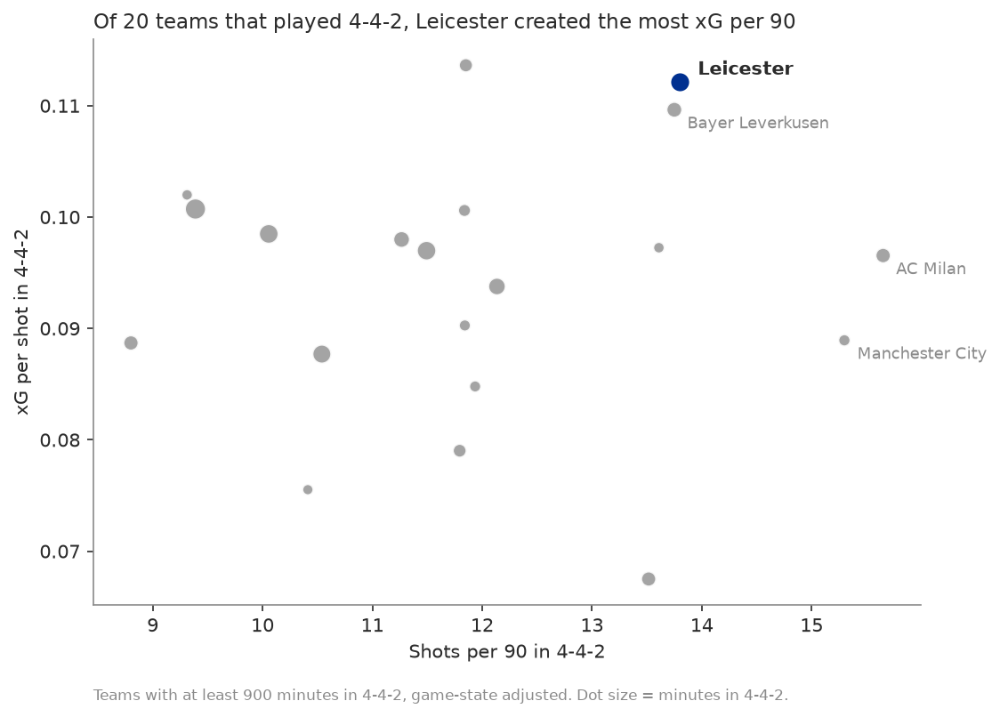

# Leicester won the 2015/16 Premier League with chance quality and a defense that beat its xG, not lucky finishing

An expected goals (xG) model built from free StatsBomb event data, used to answer one question: **how did a 5000-to-1 underdog win the league: shot quality, shot volume, or finishing luck?**

**Live app:** coming soon


## Key findings

- **Quality, not volume.** Leicester averaged 0.114 xG per shot, 2nd in the league behind Arsenal, while taking only the 8th-most shots per match (13.5).
- **Their attacking finishing was average.** They scored 57 non-penalty goals from 58.3 xG. In 10,000 simulated seasons, 61% matched or beat that total. Jamie Vardy scored 19 from 18.9 xG, exactly on par.
- **The overperformance was at the other end.** Leicester conceded 32 non-penalty goals from 44.5 xG against, 12.5 fewer than expected and the most in the league (p = 0.018).
- **Mahrez was the one standout finisher:** 13 goals from 7.2 xG (p = 0.020).
- **That gap was worth about 15 points.** Leicester won 81 points from 66.5 expected points. Their chances alone made them a top-4 side, not champions.

Counterattacks were part of the story: 12.4% of Leicester's xG came from counters, 1.8 times the rest of the league's share. Leicester also took the most penalties in the league (13, scoring 10).

This wasn't how champions usually win. Barcelona, Juventus and PSG out-shot their leagues by 21% to 29% and beat their xG by 9 to 18 goals. And among the 20 teams across Europe that played a 4-4-2, Leicester created the most xG per 90 minutes: they were an outlier, not a typical 4-4-2 side.

## The question

Leicester were 5000-to-1 to win the 2015/16 Premier League and won it by 10 points. The usual explanations are a hot streak from Vardy and Mahrez, a fast counterattacking style, or plain luck. An xG model separates *how many* chances a team creates, *how good* those chances are, and *how well* they were finished, so it can test each explanation.

## Data

[StatsBomb Open Data](https://github.com/statsbomb/open-data), loaded with [statsbombpy](https://github.com/statsbomb/statsbombpy): 5.4M events from 1,551 matches of the 2015/16 season (Premier League, La Liga, Serie A, Ligue 1 and Bayer Leverkusen's Bundesliga matches), giving 38,728 shots.

**Data provided by StatsBomb.**

## Method

**Features** (14 per shot, built in SQL with DuckDB except for the freeze frame geometry):

| Group | Features |
|---|---|
| Geometry | Distance to goal, angle between the posts |
| Shot context | Body part, technique, free kick vs open play, play pattern, first time, under pressure, open goal |
| Assist | Through ball, cutback, cross, corner, other pass, or none (from the key pass) |
| Freeze frame | Defenders between the ball and the goal, nearest defender distance, keeper distance from line and from center |

Penalties are excluded from the model and given the overall penalty conversion rate across all 5 leagues (0.751) as their xG. Own goals aren't shots. Game state and formation are used for analysis only: the model only knows what the shot looked like.

**Models:** a distance + angle logistic regression baseline, a logistic regression with all features, and XGBoost tuned with 5-fold cross-validation. All splits are grouped by match, and 20% of matches (311) are held out until the end. Each shot's final xG comes from a model that never saw that shot's match, so a team's finishing can't leak into its own xG.

## Model results

Held-out test set: 7,554 shots from 311 matches.

| Model | Log loss | Brier | ROC AUC |
|---|---|---|---|
| Baseline (distance + angle) | 0.2788 | 0.0795 | 0.761 |
| Logistic regression | 0.2544 | 0.0732 | 0.819 |
| **XGBoost** | **0.2535** | **0.0729** | **0.821** |
| StatsBomb xG (benchmark) | 0.2513 | 0.0717 | 0.824 |

XGBoost's log loss is within 0.9% of StatsBomb's own model. Across all 38,318 non-penalty shots, the model predicts 3,646.5 goals against 3,651 actual.


The model is calibrated: shots it rates at 0.2 xG go in about 20% of the time. Distance, angle and the number of defenders in the way drive it most ([SHAP summary](figures/shap_summary.png)).

## Analysis: Leicester vs the Premier League

### Finishing vs defense


### Was it luck?

Each shot is replayed 10,000 times as a coin flip weighted by its xG. The p-value is the share of simulated seasons at least as extreme as the real one.


| | Shots | xG | Actual | 90% of simulations | p |
|---|---|---|---|---|---|
| Leicester goals scored | 512 | 58.3 | 57 | 48 to 69 | 0.608 |
| Leicester goals conceded | 513 | 44.5 | 32 | 35 to 54 | 0.018 |
| Jamie Vardy | 112 | 18.9 | 19 | 13 to 25 | 0.532 |
| Riyad Mahrez | 81 | 7.2 | 13 | 3 to 11 | 0.020 |

The defensive number mixes goalkeeping (Kasper Schmeichel), last-ditch blocks and luck, and this model can't separate them: xG only measures the chance, not what happened after the shot.

### Expected points


Full tables (all 20 teams, play patterns, assist types): [figures/leicester_results.md](figures/leicester_results.md).

## Analysis: Leicester vs the other champions

Did Leicester win the way champions usually do? Each 2015/16 champion is compared with the average team in its own league, because leagues differ in how many goals they produce.


- **The usual champions dominate the ball and the shot count.** Barcelona, Juventus and PSG took 21% to 29% more shots than their league average and allowed 18% to 30% fewer. Leicester took 4% more and allowed 5% more.
- **The giants also out-finished their xG**, by 9 to 18 goals, with elite forwards doing what xG doesn't credit. Leicester's attack finished at an average rate (−1.3).
- **All three topped their league on expected points. Leicester ranked 4th.** Leicester's xG difference was +0.36 per match, against +0.90 to +1.40 for the others.
- **Leicester leaned on counterattacks:** 1.8 times their league's share of xG from counters, compared with 0.5 to 1.1 times for the other champions.

Bayern Munich isn't included because the free data covers only Leverkusen's Bundesliga matches. PSG's numbers cover 37 of their 38 matches. Full table: [figures/champions_results.md](figures/champions_results.md).

## Analysis: formations across the 5 leagues

Every team's formation and the score are tracked minute by minute through the season (starting lineups, in-game tactical shifts and goals), so each formation is measured per 90 minutes actually played in it. Teams change shape when they're chasing a game, so rates are weighted to the same mix of scorelines for every formation.


- **At the same scorelines, common formations differ only modestly:** from 0.90 xG per 90 (4-4-1-1) to 1.21 (4-3-3). The game state adjustment moves any formation's number by at most 0.02.
- **Leicester were not a typical 4-4-2 team.** Of 20 teams that played 4-4-2 for 900+ minutes, Leicester ranked 1st in xG per 90 (1.55 vs 1.11 for all other 4-4-2 minutes), 2nd in xG per shot, and 2nd in the share of xG from counterattacks (11.2% vs 6.5%).



Formation choice is tied to team quality: stronger squads favor some formations, so these are patterns, not causes. "Teams in a 4-3-3 created more xG" doesn't mean switching to 4-3-3 would create more. Full tables, including the unadjusted numbers: [figures/formations_results.md](figures/formations_results.md).

## The app

The Streamlit app opens on the Leicester finding, then lets you explore:

| Page | What's on it |
|---|---|
| The Leicester story | The headline, key numbers, the 20-team scatter, simulations, expected points |
| Team explorer | Any team in any league: shot map, goals vs xG through the season, xG by play pattern |
| Player lookup | Shot map, goals vs xG against the simulated range, conversion by body part (players with 30+ shots by default) |
| Champions | Leicester, Barcelona, Juventus and PSG against their own leagues |
| Formations | xG per 90 by formation, filtered by league and scoreline |
| About the model | Results table, calibration, SHAP and features |

## Limitations

- One season only, so a team's luck and skill can't be separated over time.
- Formation is tied to team quality, so formation comparisons show patterns, not causes.
- Player samples are small: Mahrez's 81 shots is a short run, and players with fewer than 30 shots shouldn't be judged on finishing.
- Freeze frames are a single snapshot and don't show player movement.
- xG ignores the shooter's skill by design, and pre-shot xG can't tell good goalkeeping from bad finishing.
- The free Bundesliga data covers only Leverkusen's matches, and 3 Ligue 1 matches are missing.

## How to run it

Requires Python 3.11+.

```bash
python -m venv .venv && source .venv/bin/activate
pip install -r requirements.txt

python src/download.py     # StatsBomb events -> data/raw/ (about 15 minutes)
python src/build_db.py     # DuckDB tables and features
python src/train.py        # models + data/processed/shots_with_xg.parquet
python src/evaluate.py     # metrics, calibration, SHAP figures
python src/analysis.py     # Leicester analysis figures and tables
python src/champions.py    # champions comparison
python src/formations.py   # formation analysis

pytest                     # feature, simulation and app tests
streamlit run app/streamlit_app.py
```

## Repo structure

```text
sql/            shots, features, game state, formations, formation minutes (DuckDB)
src/            download, build, freeze frame features, train, evaluate, simulate, analysis, champions, formations
app/            Streamlit app (reads data/processed/ and figures/ only)
tests/          pytest tests for features, simulations and every app page
notebooks/      exploration only
data/processed/ shots_with_xg, matches, formation_minutes (used by the app)
figures/        charts and results tables
models/         trained models
```

## Next steps

- More seasons, to test whether Leicester's defensive overperformance was skill that repeated.
- A post-shot xG model using shot end location, to separate goalkeeping from defending and luck.
- A finishing skill model for players, pooling information across seasons.
- Tracking data, to replace single-frame defender positions with movement.
